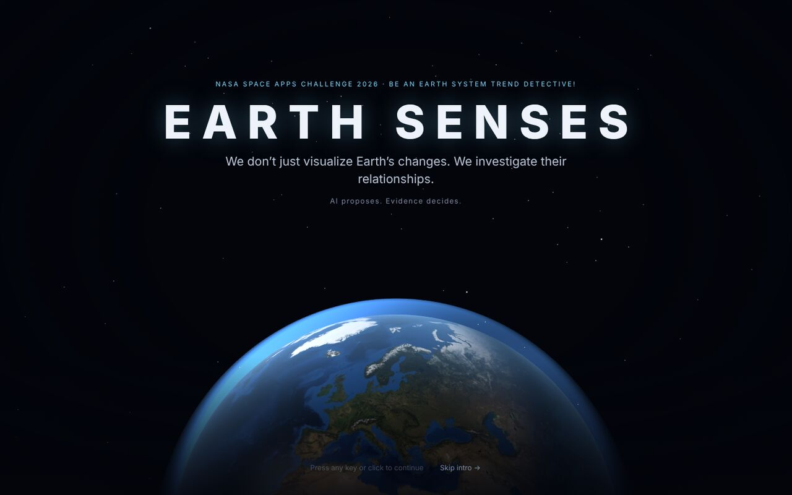
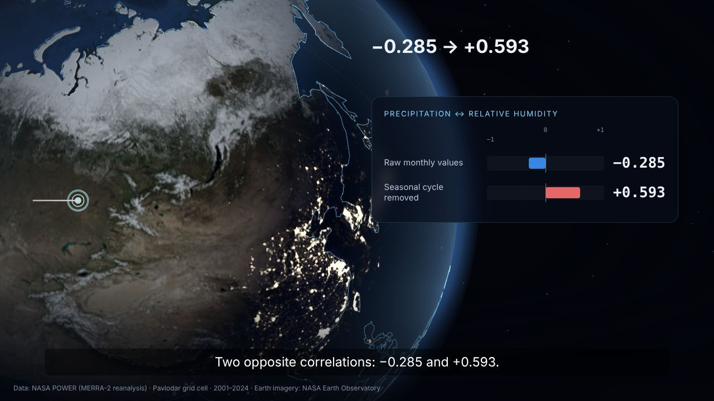
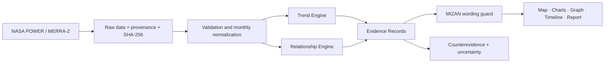

<p align="center">
  <a href="docs/brand/earth-senses-orbit.svg" title="Open the original animated orbital artwork">
    <picture>
      <source media="(prefers-reduced-motion: reduce)" srcset="docs/brand/earth-senses-orbit-static.svg">
      
    </picture>
  </a>
</p>

<div align="center">

# EARTH SENSES
### Interconnected Earth Intelligence

**An independent NASA Space Apps Challenge 2026 project**  
**Challenge:** [Be An Earth System Trend Detective!](https://www.spaceappschallenge.org/2026/challenges/earth-system-trend-detective/)

**[English](#english)** · **[Қазақша](#qazaqsha)** · **[Русский](#russian)**

`NASA POWER / MERRA-2` &nbsp; `REPRODUCIBLE SCIENCE` &nbsp; `EVIDENCE FIRST` &nbsp; `3D EARTH`

*We don't just visualize Earth's changes. We investigate their relationships, challenge our assumptions, and preserve the evidence.*

</div>

> **Mission note:** This repository belongs to an independent hackathon project, not an official NASA application or a NASA-endorsed product. The animated cover is original **illustrative artwork**, not a scientific Earth observation. GitHub may display SVG motion as a still image; open the artwork itself or launch the app for the full moving WebGL Earth.

---

<a id="english"></a>
# 🇬🇧 English

## Mission / The first answer is not always the right one

Earth's systems are connected. Temperature, precipitation and humidity follow seasonal cycles, long-term shifts and regional patterns. A striking correlation can reflect the calendar rather than the relationship we were trying to study.

**EARTH SENSES** is an interactive investigation console built for the NASA Space Apps Challenge 2026. Select a location and period, explore NASA Earth-system data, estimate rates of change and statistical significance, compare variables and regions, and open the **evidence behind each conclusion**. The application shows what the data support — and what they do not.

### The signal that changed the story

**Pavlodar grid cell, Kazakhstan · January 2001–December 2024 · 288 months · NASA POWER / MERRA-2**

| Relationship | Raw monthly correlation | After removing the seasonal cycle |
|:--|--:|--:|
| **Precipitation ↔ Relative humidity** | **−0.285** | **+0.593** |
| Temperature ↔ Relative humidity | −0.945 | −0.316 |
| Temperature ↔ Precipitation | +0.439 | −0.125 |

The precipitation–humidity relationship **reverses sign** after deseasonalization. That is the central lesson of our demo: a raw association may be driven by seasonality. The corrected correlation is **not proof of causation**. It is a result inside one reanalysis product, for one grid cell and a specified period. It is not an independent station observation.

The precipitation–humidity association also varies by season: **winter ≈ −0.06** versus **summer ≈ +0.70**. The humidity trend over 2001–2024 has a nominal `p = 0.035` but an FDR-adjusted `q = 0.105`; it is reported as **fragile**, not established. No significant temperature trend detected in this window **does not** imply that warming is absent.

[Examine the full calculations](docs/GEMINI_REPRODUCTION.md) · [Scientific self-audit](docs/SCIENCE_REVIEW.md) · [Known limitations](docs/KNOWN_LIMITATIONS.md)

<table>
  <tr>
    <td width="50%" valign="top">
      <a href="docs/visual/screenshots/01_splash_en.jpg"></a>
      <sub>Actual application: cinematic 3D Earth</sub>
    </td>
    <td width="50%" valign="top">
      <a href="docs/visual/screenshots/07_intro_flip_en.jpg"></a>
      <sub>Actual application: raw versus deseasonalized evidence</sub>
    </td>
  </tr>
</table>

## Explore the mission

| Experience | What happens |
|:--|:--|
| **3D Earth introduction** | WebGL globe with NASA Earth imagery, day/night lighting, a Pavlodar marker, animated data and an accessible 2D fallback |
| **Three languages** | English, Қазақша, Русский; language selection before the intro and an in-app switch |
| **Three film lengths** | Short (~16.5 s), Explainer (~45 s), Full (~59.5 s) in each language; filmed versions and subtitles are included |
| **Earth Explorer** | Choose coordinates, variables and a period on an interactive MapLibre map |
| **Trend Observatory** | Theil–Sen slope, confidence intervals, trend tests, seasonality and false-discovery correction |
| **Relationship Graph** | Raw, deseasonalized and detrended correlations; seasonal and lag comparisons; partial correlations |
| **View Evidence** | Source, calculation, uncertainty, alternative explanations, counterevidence and SHA-256 |
| **Evidence Timeline & Comparison** | Investigative episodes, sensitivity to period and side-by-side locations |

### Watch the real application

[**English 29-second demo with AI voice**](docs/video/renders/voiced/demo_en_voice.mp4) · [English full film](docs/video/renders/voiced/hero_en_voice.mp4) · [English explainer](docs/video/renders/voiced/explainer_en_voice.mp4) · [English short](docs/video/renders/voiced/teaser_en_voice.mp4)

These are **screen recordings from the running application**, not fabricated Earth-system footage. Some versions use labelled ElevenLabs synthetic narration; details of versions without voice appear in the [video manifest](docs/video/renders/voiced/MANIFEST.md).

## How the evidence pipeline works



**Scientific rules.** The engine does not use a language model to compute results. It separates the `YYYY13` annual summary from monthly values, checks missing-value codes and units (precipitation is provided in `mm/day`), adjusts for autocorrelation and multiple comparisons, and tests sensitivity to the chosen years. NASA POWER relative humidity is derived partly from temperature; the app flags such built-in dependence instead of presenting it as independent physical evidence.

**Methodological influences.** MIZAN / BURHAN (claims, evidence and counterevidence), BATYR AGA (verification discipline), Git Senses (history of revisions), Ghost Busters (silent-data failures), and DIYAZ METHOD (staged testing). These are project workflows, **not independently certified scientific methods**.

## Reproduce and run

Requirements: **Python 3.13**, **Node.js 22**. Start in the repository root.

```bash
python -m venv .venv
source .venv/bin/activate
pip install -r backend/requirements-dev.txt
python scripts/build_provenance.py
(cd backend && python -m pytest)
(cd frontend && npm ci && npm run build)

# Reproduce the bundled NASA case without a live API request:
EARTH_SENSES_OFFLINE=1 uvicorn earth_senses.api:app --app-dir backend --port 8000
# Open http://localhost:8000/?intro
```

For development, use a second terminal: `cd frontend && npm run dev` (http://localhost:5173). The backend serves API docs at http://localhost:8000/docs. For the scripted scientific reproduction: `python scripts/reproduce_gemini.py` and `python scripts/science_review.py`.

**Data:** NASA POWER Monthly & Annual API with underlying **MERRA-2 model reanalysis**; 0.5° × 0.625° native model grid. This is not a point weather station. Stored raw requests and integrity records live in `data/raw/` and `data/provenance/`. [NASA POWER API](https://power.larc.nasa.gov/) · [Scientific method](docs/SCIENCE_METHOD.md).

**Limits that matter:** one main reanalysis source, no independent station-based validation, trend-test limitations for highly persistent series, incomplete translation of generated findings, no completed human scientific peer review, and no guarantee that the live NASA API is reachable from every execution environment. [Full limitations](docs/KNOWN_LIMITATIONS.md). A public video URL and repository visibility must be checked separately for competition submission.

---

<a id="qazaqsha"></a>
# 🇰🇿 Қазақша

## Мақсат / Алғашқы қорытынды әрдайым дұрыс бола бермейді

Жердің табиғи жүйелері өзара байланысты. Ауа температурасы, жауын-шашын мен ылғалдылық маусымдық өзгерістерге, ұзақ мерзімді үрдістерге және аймақтық ерекшеліктерге тәуелді. Кейде екі көрсеткіштің арасындағы күшті корреляция нақты байланысты емес, тек ортақ маусымдық циклді көрсетуі мүмкін.

**EARTH SENSES** — **NASA Space Apps Challenge 2026** байқауына арнап жасалған интерактивті зерттеу құралы. Пайдаланушы картадан орынды, уақыт аралығын және айнымалыларды таңдап, NASA деректері бойынша өзгеріс қарқынын, оның статистикалық мәнділігін және көрсеткіштер арасындағы ықтимал байланыстарды талдай алады. Әрбір қорытындының артында **дереккөз, есептеу әдісі, белгісіздік және қарсы дәлелдер** көрсетіледі.

### Зерттеу нәтижесі: маусымдық циклді алып тастағанда не өзгереді?

**Павлодар орналасқан модель торының ұяшығы · 2001–2024 · 288 ай · NASA POWER / MERRA-2**

| Көрсеткіштер жұбы | Бастапқы айлық корреляция | Маусымдық циклді алып тастағаннан кейін |
|:--|--:|--:|
| **Жауын-шашын ↔ Салыстырмалы ылғалдылық** | **−0,285** | **+0,593** |
| Температура ↔ Салыстырмалы ылғалдылық | −0,945 | −0,316 |
| Температура ↔ Жауын-шашын | +0,439 | −0,125 |

Жауын-шашын мен салыстырмалы ылғалдылық арасындағы корреляцияның **таңбасы өзгерді**. Бұл бастапқы деректерді түсіндіруде маусымдық әсердің қаншалықты маңызды екенін көрсетеді. Алайда корреляция **себеп-салдар байланысын дәлелдемейді**. Нәтиже белгілі бір кезеңдегі және бір модель торы ұяшығындағы қайта талдау деректеріне қатысты.

Жауын-шашын мен ылғалдылықтың байланысы жыл мезгіліне де тәуелді: **қыста ≈ −0,06**, ал **жазда ≈ +0,70**. 2001–2024 жылдардағы ылғалдылық өсімінің бастапқы `p = 0,035` мәні көптік тексерулерге түзетуден кейін `q = 0,105` болады. Сондықтан бұл тренд **орнықсыз** деп бағаланады. Температура бойынша статистикалық мәнді тренд анықталмауы «жылыну жоқ» дегенді білдірмейді.

[Есептеулерді қарау](docs/GEMINI_REPRODUCTION.md) · [Ғылыми өзіндік тексеру](docs/SCIENCE_REVIEW.md) · [Белгілі шектеулер](docs/KNOWN_LIMITATIONS.md)

## Қосымшаның мүмкіндіктері

| Модуль | Мүмкіндігі |
|:--|:--|
| **3D Жер моделі** | NASA-ның Жер кескіндері негізіндегі WebGL-глобус, күн мен түн көрінісі, анимация және 2D балама нұсқа |
| **Үш тіл** | English / Қазақша / Русский; тілді кіріспе бейненің алдында таңдау |
| **Үш бейне нұсқасы** | Қысқа (~16,5 с), түсіндірме (~45 с), толық (~59,5 с) — әр тілде |
| **Earth Explorer** | Картадан орын, уақыт аралығы және айнымалыларды таңдау |
| **Trend Observatory** | Өзгеріс қарқыны, сенімділік аралығы және статистикалық тестілер |
| **Relationship Graph** | Айнымалылар арасындағы байланыстарды, маусымдық және уақыт бойынша ығысқан корреляцияларды салыстыру |
| **View Evidence** | Бастапқы деректер, есептеу, белгісіздік және қарсы дәлелдерді қарау |
| **Evidence Timeline** | Зерттеу жорамалдарының тексерілу және қайта қаралу тарихы |

### Бейнелерді көру

[**Қазақ тіліндегі толық бейне (озвучкамен)**](docs/video/renders/voiced/hero_kk_voice.mp4) · [Түсіндірме бейне (субтитр және музыка)](docs/video/renders/voiced/explainer_kk_music.mp4) · [Қысқа бейне (субтитр және музыка)](docs/video/renders/voiced/teaser_kk_music.mp4)

Бейнелер жұмыс істеп тұрған қосымшадан жазылған. Толық қазақша нұсқада синтезделген дауыс бар; түсіндірме және қысқа нұсқаларда **дыбыстық мәтін жоқ**, субтитрлер мен музыка берілген. [Бейне нұсқаларының тізімі](docs/video/renders/voiced/MANIFEST.md).

## Ғылыми әдіс және деректер

Жүйе **NASA POWER** қызметі арқылы **MERRA-2 модельдік қайта талдау** деректерін пайдаланады. Бағдарлама уақыт қатарларын тексеріп, маусымдық әсерді бөледі, тренд пен корреляцияларды есептейді, көптік салыстыруларға түзету енгізеді және әрбір нәтиженің дереккөзін SHA-256 бақылау сомасымен байланыстырады. **Сандарды тілдік модель есептемейді.**

Бұл — жердегі жеке метеостанцияның деректері емес: нүктелік сұрау шамамен **0,5° × 0,625° модель торы ұяшығын** білдіреді. Температура мен салыстырмалы ылғалдылықты толық тәуелсіз айнымалылар деп қарастыруға болмайды, себебі NASA POWER ылғалдылықты есептеу кезінде температураны да пайдаланады.

Инженерлік қағидалар: **MIZAN / BURHAN** — дәлелдерді тексеру; **BATYR AGA** — тексерудің қайталанымдылығы; **Git Senses** — тұжырымдардың өзгеру тарихы; **Ghost Busters** — байқалмайтын дерек қателерін анықтау; **DIYAZ METHOD** — кезең-кезеңімен әзірлеу және сынау. Бұл қағидалар дербес ғылыми стандарт ретінде расталған деп саналмайды.

### Іске қосу

**Python 3.13** және **Node.js 22** қажет. Жоғарыдағы [орнату және іске қосу командаларын](#reproduce-and-run) орындаңыз; қосымша `http://localhost:8000/?intro` мекенжайында ашылады. Офлайн режим тек бастапқы дерегі алдын ала тексерілген жиынтықтарды пайдаланады. [Ғылыми әдістеме](docs/SCIENCE_METHOD.md) · [NASA-ға тапсыру материалдары](docs/NASA_SUBMISSION.md).

**Шектеулер:** негізгі айнымалылар бір модельдік қайта талдау дереккөзінен алынған; тәуелсіз жерүсті өлшемдерімен толық салыстыру және адам жүргізген ғылыми сараптама жасалмаған. Кейбір қорытындылар қосымша ішінде әзірге ағылшын тілінде беріледі. Статистикалық мәнділік себептілікті дәлелдемейді. [Толық шектеулер](docs/KNOWN_LIMITATIONS.md).

---

<a id="russian"></a>
# 🇷🇺 Русский

## Миссия / Первый вывод не всегда верный

Земная система взаимосвязана. Температура, осадки и влажность подчиняются сезонным циклам, долгосрочным изменениям и региональным особенностям. Поэтому сильная корреляция двух показателей иногда отражает общий календарный ритм, а не ту связь, которую мы пытаемся исследовать.

**EARTH SENSES** — интерактивная исследовательская платформа, созданная для **NASA Space Apps Challenge 2026**. Пользователь выбирает регион, период и переменные, исследует данные NASA, оценивает скорость изменений и статистическую значимость, сравнивает взаимосвязи и открывает **доказательства каждого вывода**: исходные данные, методику, неопределённость, альтернативные объяснения и контрдоказательства.

### Что мы обнаружили на данных Павлодара

**Ячейка модельной сетки, охватывающая Павлодар · 2001–2024 · 288 месяцев · NASA POWER / MERRA-2**

| Пара переменных | Корреляция исходных месячных рядов | После удаления сезонного цикла |
|:--|--:|--:|
| **Осадки ↔ Относительная влажность** | **−0,285** | **+0,593** |
| Температура ↔ Относительная влажность | −0,945 | −0,316 |
| Температура ↔ Осадки | +0,439 | −0,125 |

После устранения сезонности корреляция осадков и относительной влажности **меняет знак**. Это показывает, почему нельзя делать вывод по одному графику. Но даже скорректированная корреляция **не доказывает причинно-следственную связь**: результат относится к конкретному периоду, одной ячейке сетки и одному продукту реанализа.

Связь осадков с влажностью различается по сезонам: **зимой ≈ −0,06**, **летом ≈ +0,70**. Номинальная значимость тренда влажности (`p = 0,035`) исчезает после поправки на множественные проверки (`q = 0,105`), поэтому тренд помечен как **неустойчивый**. Отсутствие статистически значимого тренда температуры за выбранный период **не означает отсутствия потепления**.

[Воспроизведение чисел](docs/GEMINI_REPRODUCTION.md) · [Научная самопроверка](docs/SCIENCE_REVIEW.md) · [Ограничения](docs/KNOWN_LIMITATIONS.md)

## Исследовательская консоль

| Возможность | Описание |
|:--|:--|
| **3D Земля** | Настоящий WebGL-глобус с изображениями NASA, терминатором дня и ночи, анимацией и 2D-режимом |
| **Три языка** | English / Қазақша / Русский; выбор перед вступлением и переключение в приложении |
| **Три версии вступления** | Короткая (~16,5 с), объясняющая (~45 с), полная (~59,5 с) на каждом языке |
| **Earth Explorer** | Интерактивная карта и выбор точки, переменных и периода |
| **Trend Observatory** | Скорость изменений, доверительные интервалы, статистическая значимость |
| **Relationship Graph** | Сравнение исходных, сезонно скорректированных и детрендированных связей, временных лагов |
| **View Evidence** | Источник данных, вычисления, допущения, контрдоказательства, SHA-256 |
| **Evidence Timeline** | История гипотез, проверок, пересмотров и сравнение регионов |

### Посмотреть видео

[**Полный фильм на русском с озвучкой**](docs/video/renders/voiced/hero_ru_voice.mp4) · [Объясняющая версия](docs/video/renders/voiced/explainer_ru_voice.mp4) · [Короткий тизер](docs/video/renders/voiced/teaser_ru_voice.mp4)

Это записи настоящего приложения, а не вымышленные кадры измерений. Использованная синтезированная озвучка обозначена в видео. [Манифест видеоматериалов](docs/video/renders/voiced/MANIFEST.md).

## Научная основа

Источник — **NASA POWER**, модельный реанализ **MERRA-2**. Движок проверяет полноту календаря и единицы измерения, отделяет сезонный цикл, рассчитывает Theil–Sen, статистические тесты трендов и корреляции, учитывает автокорреляцию и множественные сравнения. Результаты связаны с исходными ответами NASA и контрольными суммами **SHA-256**. Численные результаты **не генерируются языковой моделью**.

Важно: запрос точки возвращает значение **ячейки модельной сетки 0,5° × 0,625°**, а не измерение на конкретной городской метеостанции. Кроме того, относительная влажность NASA POWER рассчитывается с использованием температуры, поэтому часть связи этих показателей встроена в определение переменной.

При разработке применены принципы **MIZAN / BURHAN** (доказательства и опровержения), **BATYR AGA** (воспроизводимость), **Git Senses** (хронология изменений), **Ghost Busters** (тихие ошибки данных) и **DIYAZ METHOD** (этапная разработка с проверками). Они используются как инженерные подходы, а не как независимо подтверждённые научные стандарты.

### Запуск проекта

Требуются **Python 3.13** и **Node.js 22**. Команды приведены в разделе [Reproduce and run](#reproduce-and-run). После установки приложение открывается по адресу `http://localhost:8000/?intro`. Для демонстрации без сетевого доступа используйте `EARTH_SENSES_OFFLINE=1` — только сохранённые и проверенные наборы данных. [Научная методика](docs/SCIENCE_METHOD.md) · [Материалы для NASA](docs/NASA_SUBMISSION.md).

**Ограничения:** пока нет полноценной независимой валидации на другом продукте NASA и данных метеостанций, научного ревью человеком, а также полного перевода автоматически сформированных выводов. Сама статистическая связь не устанавливает причину. [Полный перечень ограничений](docs/KNOWN_LIMITATIONS.md).

---

## Sources, credits & openness / Дереккөздер мен авторлық / Источники и авторство

- **Challenge:** [NASA Space Apps Challenge 2026 — Be An Earth System Trend Detective!](https://www.spaceappschallenge.org/2026/challenges/earth-system-trend-detective/)
- **Earth-system data:** [NASA POWER](https://power.larc.nasa.gov/) · MERRA-2 reanalysis, NASA GMAO.
- **Earth imagery:** NASA Earth Observatory, Blue Marble: Next Generation and Earth at Night 2012, distributed through NASA WorldWind; coastline and water-mask inputs from Natural Earth. [Image provenance and attribution](docs/visual/ASSETS_AND_LICENSES.md).
- **Methods and provenance:** [Scientific method](docs/SCIENCE_METHOD.md) · [Evidence ledger](docs/EVIDENCE_LEDGER.md) · [Science self-audit](docs/SCIENCE_REVIEW.md) · [Video credits](docs/video/renders/voiced/MANIFEST.md).
- **AI disclosure:** Gemini provided an exploratory analysis; Claude assisted with implementation, tests, documentation and review under the team's direction. Scientific numbers come from reproducible calculations, **not** from LLM-generated estimates. Some films include clearly labelled synthetic ElevenLabs voices. See [submission notes](docs/NASA_SUBMISSION.md).
- **Team and licensing:** The project belongs to the hackathon team operating this repository. Code licensing remains the repository owner's decision; external NASA and Natural Earth assets retain their respective terms and required credits.

<div align="center">

### OBSERVE THE CHANGE. QUESTION THE PATTERN. FOLLOW THE EVIDENCE.

**AI proposes. Evidence decides. Earth Senses investigates.**

[↑ English](#english) · [↑ Қазақша](#qazaqsha) · [↑ Русский](#russian)

</div>
